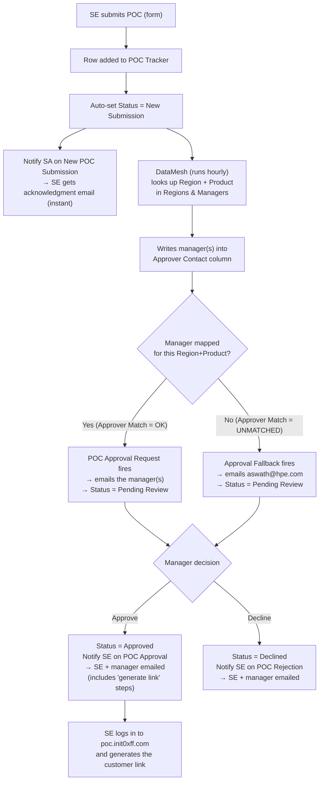
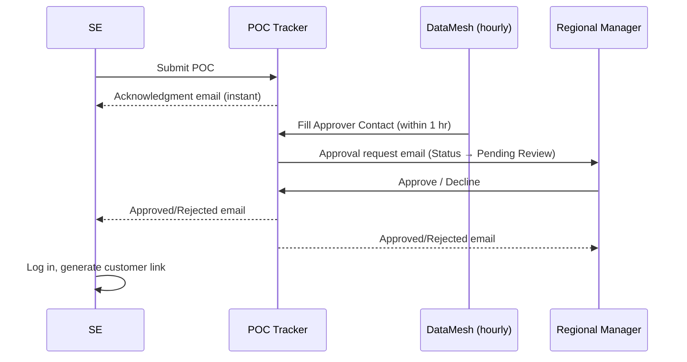
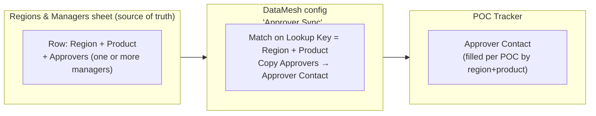

# POC Approval Automation — KT / Handover

**Audience:** SA team, regional managers, and whoever maintains the tracker.
**Purpose:** explain how a POC moves from submission to approval, how approver
routing is configured, how to add/remove approvers, how often it runs, the
limitations, and what to do when something looks wrong.

---

## 1. TL;DR

An SE submits a POC in the **HPE Morpheus POC Tracker**. The SE gets an instant
acknowledgment. Within an hour, the right **regional/product manager** is filled
in automatically and emailed an approve/decline request. When they approve, the
SE and manager are notified and the SE generates the customer link. Approvers are
maintained in **one sheet** — *Regions & Managers* — so adding or removing a
manager is a single cell edit; no automation changes needed.

---

## 2. End-to-end flow

### Timeline view

---

## 3. How approver mapping works

Approvers are **not** hardcoded in any workflow. They live in one sheet and are
copied into the tracker by DataMesh.

- **Regions & Managers** has one row per Region + Product, with an **Approvers**
  cell that can hold one or more managers (e.g. Americas + VM Essentials = Matt
  Haron + Alex Irizarry).
- **DataMesh** matches each POC's Region + Product to that sheet and copies the
  managers into the POC's **Approver Contact** cell.
- The approval and notification emails are sent to **Approver Contact** — so they
  always reflect whatever is in the manager sheet.

---

## 4. How often it runs / timing

| Step | Timing |
|------|--------|
| SE acknowledgment email | **Instant** (on submission) |
| DataMesh fills the approver | **Within 1 hour** (hourly schedule) |
| Approval request email to manager | Fires the moment DataMesh fills the approver (so ≤ 1 hr after submission) |
| Approve / Reject / Extend / Block / Complete emails | **Instant** (on the status change) |
| Expiry reminders (10 / 7 / 5 / 3 days + expired) | Daily check at 9:00 AM |
| Manager change in the sheet → reflected on POCs | **Within 1 hour** (next DataMesh run) |

---

## 5. All notifications (who gets what)

| Event | Email | Recipients |
|-------|-------|-----------|
| POC submitted | Acknowledgment | SE |
| Approver filled (≤1 hr) | Approve/Decline request | Manager(s) for that region+product (or aswath if none) |
| Approved | "Approved" + generate-link steps | SE + Manager |
| Rejected / Declined | "Not approved" | SE + Manager |
| Extended | "Extension granted" | SE + Manager |
| Blocked | "Blocked" | SE + Manager |
| Completed | "Completed" | SE + Manager |
| 10 / 7 / 5 / 3 days before expiry, and on expiry | Expiry reminder | SE + Manager |

---

## 6. Adding or removing an approver (the only routine task)

**To change who approves an existing Region + Product:**
1. Open the **Regions & Managers** sheet.
2. Find the row for that Region + Product.
3. Edit the **Approvers** cell — add or remove people (it accepts multiple).
4. Save.
5. Within the hour, every matching POC picks up the change automatically.

**To add a brand-new Region + Product combination:**
1. Add a new row in **Regions & Managers**.
2. Fill: **Region**, **Product**, **Lookup Key** (must be exactly
   `Region|Product`, e.g. `Americas|HPE Morpheus Enterprise`), and **Approvers**.
3. Save. New POCs matching it route automatically.

> That's it. You never touch a workflow to change approvers.

---

## 7. Limitations (and why this method)

- **Approval email is not instant — up to 1 hour.** The approver column must
  contain *real* contacts for Smartsheet to email them, and only DataMesh writes
  those. DataMesh's fastest schedule is hourly. (The SE acknowledgment and all
  status-change emails *are* instant — only the first approver email waits for
  DataMesh.)
- **Why not instant?** Smartsheet cannot email "contacts in a cell" if the cell
  is filled by a formula, and its automations can't look up a manager from
  another sheet on the fly. So a tool (DataMesh) has to copy real contacts in,
  and that runs on a schedule. True instant routing would require a custom script
  / integration, which was intentionally avoided to keep everything inside
  Smartsheet.
- **"Update Immediately" was rejected** because it only reacts to changes in the
  *manager* sheet — it does **not** fire when a new POC is added. Hourly covers
  both.
- **Status values "Pending Review" and "Declined"** are written by Smartsheet's
  approval feature, not by us. They're now valid picklist options.

---

## 8. Troubleshooting — when something looks wrong

| Symptom | Likely cause | Fix |
|---------|--------------|-----|
| POC stuck in **New Submission**, Approver Contact **filled** | Approver was filled before the approval workflow existed (legacy), so no "change" fired | Clear the Approver Contact cell, then run DataMesh on demand — it refills and triggers the approval. (Or use the workflow's "Run now".) |
| POC stuck in **New Submission**, Approver Contact **blank**, `Approver Match = OK` | DataMesh hasn't run yet | Wait for the next hourly run, or run DataMesh on demand |
| POC stuck, `Approver Match = UNMATCHED` | No manager row for that Region + Product | Add the combination in Regions & Managers; meanwhile the fallback emails aswath |
| Manager didn't get the approval email | Approver Contact empty, or wrong email in the manager sheet | Check Approver Contact is filled and that Regions & Managers has the correct address |
| SE didn't get an email | Invalid SE Email on the POC (e.g. a typo like `name@hpe.como`) | Correct the SE Email on that row |
| Wrong manager approving | The Approvers cell for that Region + Product is wrong | Fix the cell in Regions & Managers |
| Expiry reminder didn't fire | POC isn't Approved/Extended, or no Expected End Date | Reminders only run for Approved/Extended POCs with a valid end date |
| Decline didn't notify | (Already handled) Rejection workflow triggers on **Rejected OR Declined** | Confirm that workflow still lists both values |

**Where to look first:** on the POC row, check three columns —
`Status`, `Approver Contact` (is the manager there?), and `Approver Match`
(`OK` vs `UNMATCHED`). Those three answer 90% of "why didn't it route" questions.

---

## 9. Key components reference

| Component | What / where |
|-----------|--------------|
| POC Tracker | Main sheet — intake, status, automations |
| Regions & Managers | Approver source of truth — edit the `Approvers` cell here |
| DataMesh "Approver Sync" | Copies managers into the tracker hourly |
| Workflows | ~16 automations (submission, approval request + fallback, approve/reject/extend/block/complete, 10/7/5/3-day + expired reminders) |
| App | poc.init0xff.com — SE logs in to generate the customer link after approval |

For the detailed technical reference (column IDs, exact triggers, agent prompts),
see `SMARTSHEET_APPROVAL_AUTOMATION.md`.
